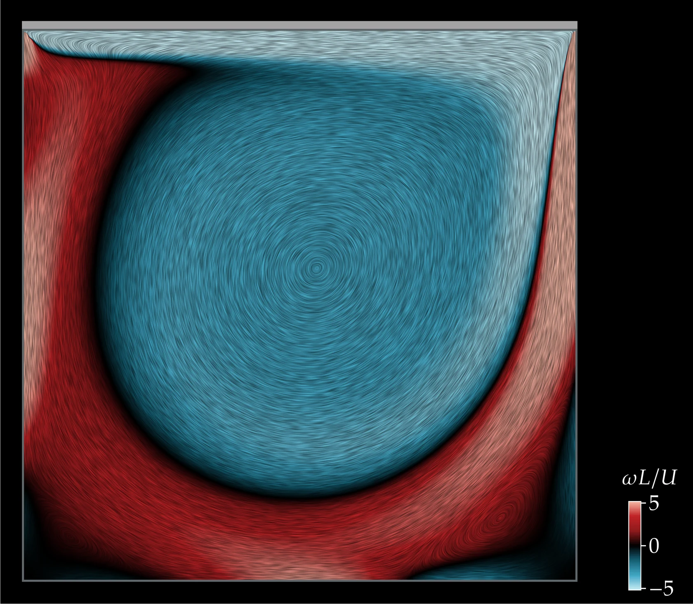

# Cavity flow

**Lid-driven cavity flow in a few lines of Python.**



A compact solver for the two-dimensional lid-driven cavity: a staggered grid, an explicit velocity update and a pressure projection solved with a discrete cosine transform.

## Get started

```bash
git clone https://github.com/EngFlavioMartins/cavity-flow.git
cd cavity-flow
pip install -r requirements.txt
python run_example.py
```

This is a short setup check; results go to `outputs/quickstart/`. For the original window-based interface, run `python MAIN.py`.

## Make the figure above

```bash
sh scripts/render/make_figure.sh
```

You need [ParaView](https://www.paraview.org/download/) (for `pvpython`), a LaTeX installation, and `pip install pyvista pillow`. The script runs the solver at Re = 1000 to steady state (about 4 minutes) and checks it against Ghia, Ghia & Shin (1982) before drawing.

## Cite

This educational solver is not tied to a paper. If you use it, please cite the repository; the benchmark used to check it is:

```bibtex
@article{ghia1982,
  author  = {Ghia, U. and Ghia, K. N. and Shin, C. T.},
  title   = {High-{Re} Solutions for Incompressible Flow Using the {Navier--Stokes} Equations and a Multigrid Method},
  journal = {Journal of Computational Physics},
  volume  = {48},
  number  = {3},
  pages   = {387--411},
  year    = {1982},
  doi     = {10.1016/0021-9991(82)90058-4}
}
```

GitHub's **Cite this repository** button (from [CITATION.cff](CITATION.cff)) gives the same reference in other formats.

## Licence

MIT; see [LICENSE](LICENSE). The DCT approach credits [Michio Inoue's cavity solver](https://github.com/mathworks/2D-Lid-Driven-Cavity-Flow-Incompressible-Navier-Stokes-Solver).
