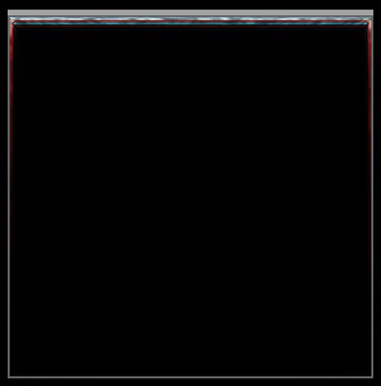

# Cavity flow

<p align="center">
  <a href="https://github.com/EngFlavioMartins/cavity-flow/actions/workflows/example.yml"></a>
  <a href="https://www.python.org/"></a>
  <a href="https://github.com/EngFlavioMartins/cavity-flow/blob/HEAD/LICENSE"></a>
  <a href="https://engflaviomartins.github.io/#cavity-flow"></a>
</p>

**Lid-driven cavity flow in a few lines of Python.**

<p align="center"></p>

A compact, readable solver for the classic two-dimensional lid-driven cavity: a staggered grid, an explicit velocity update and a pressure projection solved with a discrete cosine transform. It is small enough to read in one sitting and checked against the Ghia, Ghia & Shin (1982) benchmark.

## Run it

```bash
git clone https://github.com/EngFlavioMartins/cavity-flow.git
cd cavity-flow
python run.py
```

`run.py` runs the cavity at Re = 100 to steady state (a second or two) and plots it to `outputs/quickstart/velocity.svg`. The first time, it installs what it needs into a private `.venv` folder (a minute or so); after that it starts at once. All you need is Python 3.10 or newer.

<details>
<summary>Prefer conda?</summary>

```bash
conda env create -f environment.yml
conda activate cavity-flow
python run_example.py
```

</details>

**Next:** Try `python run.py --reynolds 400 --grid 64 --t-end 60` for a stronger vortex, or `python MAIN.py` for the original window-based interface.

## Figure and animation

<p align="center"></p>

The steady flow at Re = 1000. The texture follows the flow direction; the colour is the vorticity (teal clockwise, red anticlockwise).

```bash
sh scripts/render/make_figure.sh          # the figure
python scripts/render/make_animation.py   # the animation at the top
```

The figure needs [ParaView](https://www.paraview.org/download/) and LaTeX; the animation only Python.

## Cite

There is no paper for this solver. If it helps your work, please cite the repository:

```bibtex
@misc{martins_cavity_flow,
  author       = {Martins, Flavio A. C.},
  title        = {Cavity flow: a lid-driven cavity solver in {Python}},
  year         = {2022},
  howpublished = {\url{https://github.com/EngFlavioMartins/cavity-flow}},
  note         = {Software, Apache-2.0 licence}
}
```

The benchmark used to check it is Ghia, Ghia & Shin (1982), [doi:10.1016/0021-9991(82)90058-4](https://doi.org/10.1016/0021-9991(82)90058-4).

GitHub's **Cite this repository** button (from [CITATION.cff](CITATION.cff)) gives the same reference in other formats.

## Licence

[Apache 2.0](LICENSE): you are free to use, change and share this code, also commercially. If you pass it on, keep the [NOTICE](NOTICE) file with it; it says where the code comes from and how to cite it.

The DCT approach credits [Michio Inoue's cavity solver](https://github.com/mathworks/2D-Lid-Driven-Cavity-Flow-Incompressible-Navier-Stokes-Solver).
